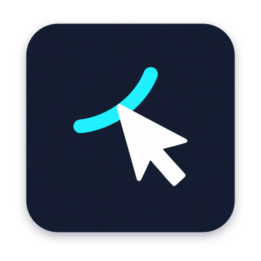
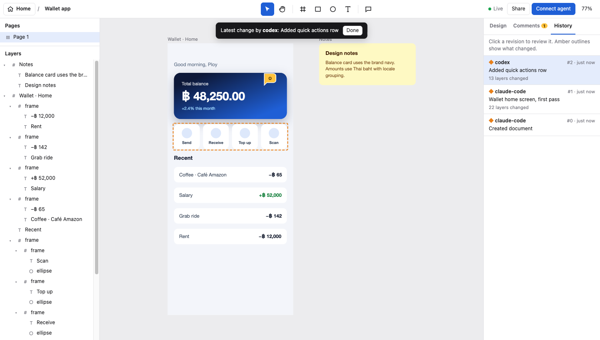

<p align="center"></p>

<h1 align="center">Draft</h1>

<p align="center"><b>A drawboard for your agent. MCP or CLI.</b><br>
Let your agent draw screens, diagrams and ideas. Watch it work, move things around, and leave feedback on the board.<br>
Self-hosted. Open source. Your designs stay on your disk.</p>

<p align="center">
<a href="https://github.com/krittaprot/draft/actions/workflows/ci.yml"></a>
<a href="LICENSE"></a>
</p>



## Draw together

- **Give your agent a board.** Create frames, text, shapes, SVGs and images with auto-layout. Use MCP tools or call the same tools from the CLI.
- **See what it made.** Agent edits appear live. Screenshots and share links let the agent check its work and show you the result.
- **Make it yours.** Move and resize layers, adjust styles, and pin feedback directly to the design.
- **Keep every version.** Each change records its author. Review the history or restore an earlier revision.
- **Own your work.** A small Node.js server, files on your disk, and an MIT licence.

## Self-host locally

Install **Node.js 20+**, **pnpm**, and **Git**, then run:

```bash
git clone https://github.com/krittaprot/draft.git
cd draft
pnpm install --frozen-lockfile
pnpm build
node bin/draft.js serve --data "$HOME/.local/share/draft/data"
```

Keep that terminal running and open **http://127.0.0.1:3290**.

1. On first launch, Draft creates an owner key and prints its file path.
2. In a second terminal, read it with `cat "$HOME/.local/share/draft/data/owner-token"` and use it to sign in. Keep this key private.
3. Connect an agent through MCP or use the CLI below.

Stop the server with Ctrl+C. Restart it with the same command and data directory to reopen your boards.

### Data and configuration

New installations store data in `~/.local/share/draft/data`. Set `DRAFT_DATA` or use `--data DIR` to choose another location. Back up the entire data directory while the server is stopped; it includes designs, revisions, assets and access settings. Keep data outside the source checkout.

Common options:

```bash
node bin/draft.js serve --port 3290 --data "$HOME/.local/share/draft/data"
node bin/draft.js --help
```

The server binds to `127.0.0.1` by default. Local setup needs no domain, Google account or tunnel.

### Mac app

With Xcode Command Line Tools installed, run from the project root:

```bash
./scripts/install.sh
```

This installs `~/Applications/Draft.app` and the `draft` command in `~/.local/bin`. Add that directory to your `PATH` if needed. Open Draft to use a running local server, or let the app start its bundled server while it is open. Choose **Draft → Settings…** to connect to another server.

The web app can also be installed through Safari's **File → Add to Dock**, or **Share → Add to Home Screen** on iPhone.

## Connect through MCP

From the machine hosting Draft:

```bash
draft connect claude
draft connect codex
draft connect opencode
```

Without the Mac installer, substitute `node bin/draft.js` for `draft`. Each command creates a named agent key and registers the MCP connection. Restart the agent to load its new tools.

For remote MCP clients, use **`https://your-host/mcp`**. Clients with OAuth sign in through the browser and request your approval. For bearer-token clients, create a named key with `draft token create my-agent` and use it as an Authorization bearer token. A `viewer` key can inspect designs and take screenshots without editing them.

## Draw through the CLI

Use the same drawing tools from a shell or an agent with terminal access. In a second terminal, set a key for your own server:

```bash
export DRAFT_TOKEN="$(cat "$HOME/.local/share/draft/data/owner-token")"

# Discover tools and their JSON input schemas.
draft tools

# Create a board. Copy its returned document ID into the next command.
draft call create_document '{"name":"My first board"}'
draft call create_nodes '{"document":"d_REPLACE_ME","nodes":[{"type":"frame","name":"Hello","width":640,"height":400,"fill":"#0D1838","layout":"column","padding":48,"children":[{"type":"text","text":"Hello, Draft","fontSize":40,"color":"#ffffff"}]}]}'

# Capture the board; the result includes a PNG share link.
draft call screenshot '{"document":"d_REPLACE_ME"}'
```

Use `--url https://your-host` for a remote server. For larger inputs, use `draft call create_nodes --file nodes.json`, or pipe JSON into `draft call create_nodes --file -`. Output is JSON; a failed tool call exits nonzero. Use a named editor key instead of the owner key for ongoing agent work.

## What agents can do

Both MCP and CLI expose the same tools:

- **Create and edit:** documents, frames, text, shapes, images, SVGs, auto-layout, gradients and shadows.
- **Organize:** move, duplicate and delete nodes; manage pages.
- **Inspect and share:** screenshots, node properties, document outlines, signed PNG links.
- **Export:** SVG or HTML/CSS.
- **Collaborate:** pin, read, reply to and resolve comments.
- **Review:** inspect revision history and restore earlier versions.

People get an infinite canvas, layers panel, style inspector, comment pins and live change highlights in the browser or Mac app.

## Self-host on an always-on Mac

For remote access, use a domain you control and Cloudflare Tunnel. Install `cloudflared`, sign in with `cloudflared tunnel login`, then copy `deploy/deploy.env.example` to `deploy/deploy.env` and set your hostname, service label and tunnel name.

Run from the project root:

```bash
./scripts/deploy.sh
./scripts/install-service.sh
./scripts/setup-tunnel.sh
```

The scripts publish a release, install the server launch agent and configure the tunnel. The server stays on loopback; the tunnel provides public HTTPS. These launchd scripts are macOS-specific. On Linux, run the Node server under your own process manager and HTTPS reverse proxy, with a persistent data directory.

- **Update:** pull the latest source, run `pnpm install --frozen-lockfile`, then `./scripts/deploy.sh`.
- **Verify:** check `https://your-host/healthz`, sign in, and open an existing board.
- **Rollback:** point the deployment's `current` symlink at its `previous` release, then restart `<your-label>.server` with launchctl.
- **New deployments:** releases and data live under `~/.local/share/draft`; logs live under `~/Library/Logs/Draft`.

### Sign-in for a public server

Set `DRAFT_NEON_AUTH_URL` to your [Neon Auth](https://neon.com/docs/auth/overview) endpoint and add the public URL as a trusted domain. Configure Google sign-in in Neon, then allow members:

```bash
draft member add you@example.com --role owner
```

Set `DRAFT_ALLOWED_EMAILS` for a fixed email allowlist. With Google enabled, browser token login defaults to local-only; `DRAFT_TOKEN_LOGIN` accepts `on`, `local`, or `off`. Without Neon, sign in with an access key; explicitly set `DRAFT_TOKEN_LOGIN=on` if you want remote token sign-in.

Treat owner keys as secrets. MCP and API calls require authentication; signed screenshot links are viewable by anyone who has the link until they expire. Back up your data before updates.

## Develop

```bash
pnpm install --frozen-lockfile
pnpm typecheck
pnpm test
node bin/draft.js serve --port 3299 --data /tmp/draft-dev
./scripts/build-app.sh
```

Use a scratch data directory for testing. `src/shared` contains the model and renderer; `src/server` contains storage, HTTP, MCP and CLI; `src/web` contains the editor and homepage; `mac` contains the native wrapper.

See [CONTRIBUTING.md](CONTRIBUTING.md), [SECURITY.md](SECURITY.md), and [AGENTS.md](AGENTS.md) for contribution and development guidance.

Text measurement uses the real metrics of the face that will be rendered for the 39 bundled families (advance widths, ascender/descender), so the editor, the SVG and the server PNG wrap identically. Families outside the catalogue fall back to Helvetica metrics. Server rendering also uses installed system fonts and any fonts added to `<data>/fonts`.

### Fonts

`src/shared/font-catalog.json` lists the families and weights Draft ships (Inter, Geist, Roboto, Open Sans, Lato, Montserrat, Poppins, Work Sans, DM Sans, Manrope, Space Grotesk, Plus Jakarta Sans, Figtree, Public Sans, Outfit, Archivo, Barlow, Rubik, IBM Plex Sans/Mono, Source Sans 3, Source Serif 4, Noto Sans, Oswald, Bebas Neue, Anton, Playfair Display, Merriweather, Lora, Libre Baskerville, EB Garamond, DM Serif Display, Instrument Serif, Fraunces, JetBrains Mono, Fira Code, Roboto Mono, Space Mono, Geist Mono) — 248 faces including the italics Google actually ships.

`pnpm fonts` downloads the families and regenerates `src/shared/font-data.ts` plus `src/shared/fonts.lock.json` (a sha256 of every font file); it is the only thing that writes the metrics. A build verifies that every declared face is on disk **and** that no binary changed since the metrics were written, and fails otherwise — so a release can never ship a stylesheet, a metric table and a set of font files that disagree. `DRAFT_FONTS_OFFLINE=1` downgrades that to a warning for machines without network, and `pnpm fonts:check` reports missing faces on its own.

`build.mjs` writes `/fonts.css` with one `@font-face` per available face, each URL carrying its content hash, so a stylesheet and the binaries it names are always the same pair (the stylesheet is versioned like every other asset).

Typography rules the editor and the renderer share: canvas text sets `font-synthesis: none`, so a weight or italic the family does not actually ship is not faked — it falls back to the nearest real face, exactly as resvg renders it. New text nodes default to Inter; existing documents keep the family they were saved with. Agents can call `list_fonts`, and `create_nodes`/`update_nodes` warn when they use an unknown family or an italic the family cannot draw.

The font files are large, so `src/web/fonts/<slug>/` is git-ignored while the generated metrics are committed.

## Licence

[MIT](LICENSE).
